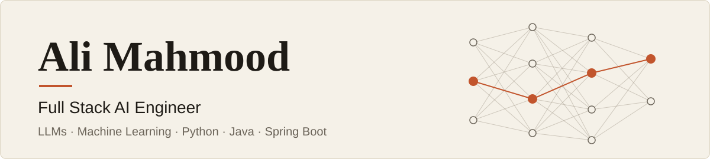

<picture>
  <source media="(prefers-color-scheme: dark)" srcset="./banner-dark.svg">
  
</picture>

I build LLM systems and the backends they run on. I fine-tune and quantize models, work on inference performance, and ship production Java and Spring Boot services around them.

Most of what I've learned comes from putting AI into real systems with real business rules. The hard part is rarely the model. It's knowing when to trust it, working out why it failed, and making failures visible to the people who have to act on them.

- **Now:** building AI features (RAG, LLM pre-screening, multi-agent pipelines) for a clinical-trial platform.
- **Before:** AI/ML at ASML, evaluating and fine-tuning vision-language models. Before that, Spring Boot microservices for enterprise clients at GoSaaS AI.
- **Studied:** MSc in AI (Erasmus Mundus EMAI), BSc in Computer Science at NUST.
- **Places:** I've studied and worked in Pakistan, Spain, Slovenia, the UK and the Netherlands.

## Things I've built

- [**Legacy UI Facade Maker**](https://github.com/alihawk/legacy-facade): turns legacy REST and SOAP APIs into React interfaces, using an LLM to clean up cryptic field names. Built solo, 219 tests.
- [**Transport mode inference**](https://github.com/alihawk/modes-of-transportation-ds): a PySpark pipeline that cleans 900M+ location pings down to about 130M usable samples.
- [**Uncertainty estimation for long-form RAG**](https://github.com/alihawk/rag-uncertainty-longform): hybrid retrieval over 6M+ Wikipedia passages with Qwen2.5-7B, scoring how uncertain each answer is.
- [**Sunflower yield estimation**](https://github.com/alihawk/sunflower-dashboard-and-detection): YOLOv7 head counting from UAV images at about 93% accuracy, plus a live dashboard. My final year project.

## Tools

- **AI/ML:** Python, PyTorch, Hugging Face, LangChain, LangGraph, MLflow, FastAPI, PySpark
- **Backend:** Java, Spring Boot, PostgreSQL, Redis, Docker, Azure, Jenkins
- **Frontend:** React, TypeScript

## Open to work

Full-time AI, ML and agentic AI roles in the Netherlands, and remote contract work with US teams (US hours, based in Europe).

Reach me on [LinkedIn](https://www.linkedin.com/in/muhammadalimahmood/), at muhammad.ali.hawk@gmail.com, or see more at [alimahmood.dev](https://alimahmood.dev).
